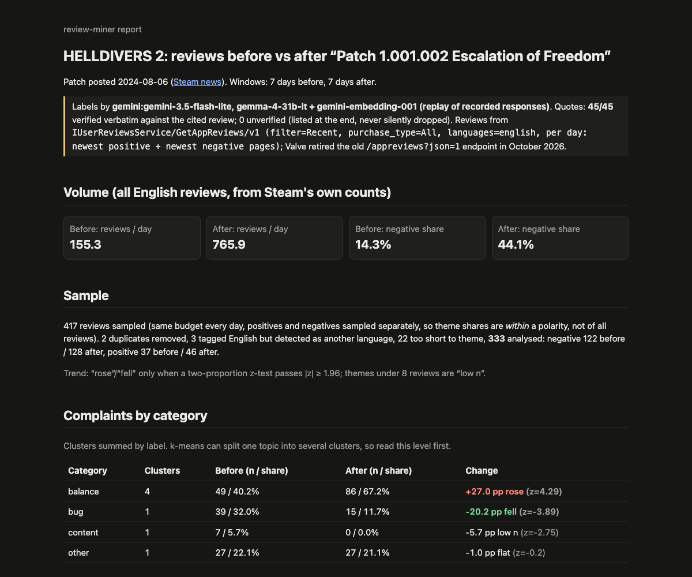

# review-miner

Turn Steam reviews into product themes (bugs, balance, monetization, performance, content, UX)
and compare the windows before and after a patch. Every quote in the output is checked against
the review it cites, and quotes that fail the check are listed, not dropped.

## Try it

**Live reports:** <https://oguzhanozfe.github.io/review-miner/> (Stardew Valley 1.6, Cyberpunk 2077
Update 2.0, HELLDIVERS 2 Escalation of Freedom).

[](https://oguzhanozfe.github.io/review-miner/helldivers-2-escalation/report.html)

```bash
git clone https://github.com/oguzhanozfe/review-miner && cd review-miner
python -m review_miner demo        # no key, no install; writes out/demo/index.html
```

`demo` picks a model on its own. If `GEMINI_API_KEY` (or `OPENAI_API_KEY`) is set, it uses that
provider live. Otherwise it uses a local Ollama at `127.0.0.1:11434` if `qwen3.5:9b` and
`qwen3-embedding:0.6b` are pulled. Otherwise it replays the recorded Gemini responses committed in
`replay/` and prints `mode: replay (...)`. Replay reproduces the committed example reports exactly,
and CI checks that on every push. Force a mode with `--mode live|local|replay|offline`.
Fetching fresh reviews from Steam is optional and needs no key either (`collect`, below), but
replay only covers the bundled fixtures, so new data needs a key, Ollama or `--backend offline`.

> **Endpoint note (Nov 2026).** `store.steampowered.com/appreviews/<appid>?json=1` answered `302`
> to the store front page when tested on 2026-11-17, and Valve's docs now mark it deprecated.
> Developer reports put the cutover around 2026-10-22. This tool uses the documented
> replacement, [`IUserReviewsService/GetAppReviews`](https://partner.steamgames.com/doc/webapi/IUserReviewsService#GetAppReviews).
> It takes the same filters, as enums inside `input_json`, needs no key, and adds date-range
> filters. Redirects are never followed, so a retired endpoint fails loudly instead of parsing
> HTML.

## Why it matters

Review dashboards show a score. A producer deciding what to fix next needs to know which
complaints changed after a patch, by how much, and which reviews say so. An LLM summary alone
can't be trusted for that, because small models paraphrase and sometimes invent quotes. So this
pipeline treats the model as a labeller and checks every claim against the source text.

## How it works

1. **Collect** (`review_miner/steam.py`). The patch date comes from `ISteamNews/GetNewsForApp`.
   For every day in the windows before and after the patch, it fetches the newest English-tagged
   positive reviews (one page) and negative reviews (two cursor pages). It also records Steam's
   `total_matching` for each day and polarity. Every day gets the same budget, so a launch-day
   spike can't swamp the sample, and complaints aren't drowned out on a 98%-positive game.
   Requests are rate-limited (1.5 s by default) and back off on 429/5xx. Author SteamIDs and
   hardware are dropped at record time.
2. **Prepare** (`analyze.py`, `text.py`). Drops duplicate ids and copy-paste texts. Runs a small
   stdlib language detector (scripts plus stopwords) and flags reviews tagged English that are
   written in another language. Reviews under 5 words are set aside.
3. **Cluster.** Embeds the reviews (`gemini-embedding-001` at 768 dimensions by default) and runs spherical
   k-means separately for complaints and praise. Both windows go into one clustering, so a theme
   means the same thing on both sides.
4. **Label.** The LLM (`gemini-3.5-flash-lite` by default, temperature 0, JSON mode) sees up to 12 reviews
   nearest the centroid, drawn evenly from both windows. It returns a category, a theme name, a
   one-sentence summary, 2-3 verbatim quotes with review ids, and feature requests with
   supporting quotes.
5. **Verify** (`quotes.py`). A quote passes only if, after one documented normalisation, it is a
   substring of the review it cites. That review must be in the cluster. The normalisation is
   NFKC, ASCII quotes and dashes, BBCode stripped, whitespace and `\r\n` collapsed, casefolded,
   and wrapping quote marks or edge ellipses removed. Stitched quotes (`a ... b`) fail.
6. **Compare.** For each theme, it counts reviews before and after and their share of that
   side's sampled reviews of the same polarity. It then runs a two-proportion z-test. A theme is
   called `rose` or `fell` only when |z| ≥ 1.96, and themes under 8 reviews are marked `low n`.
   True volume and negative share come from Steam's own counts, not from the sample.
7. **Report.** `report.html` (static, no JS) plus `report.json` with every number, quote,
   verification result and member review id.

## Run it

Python 3.10+, no dependencies.

```bash
# offline: recorded fixtures, no network, no model (TF-IDF + keyword lexicon labeller)
python -m review_miner.cli analyze fixtures/helldivers-2-escalation.json --backend offline --out out/hd2

# real labels: Gemini (default; needs GEMINI_API_KEY, free tier is enough for these fixtures)
python -m review_miner.cli analyze fixtures/helldivers-2-escalation.json --out out/hd2

# or DeepSeek (DEEPSEEK_API_KEY; TF-IDF vectors, as DeepSeek has no embeddings API),
# or a local model through Ollama (qwen3.5:9b + qwen3-embedding:0.6b by default)
python -m review_miner.cli analyze fixtures/helldivers-2-escalation.json --backend deepseek --out out/hd2
python -m review_miner.cli analyze fixtures/helldivers-2-escalation.json --backend ollama --out out/hd2

# record fresh fixtures from Steam (network; about 1.5 s between requests)
python -m review_miner.cli collect --games games.json --out fixtures

# tests
python -m unittest discover -s tests
```

`--backend openai` uses any OpenAI-compatible API through `OPENAI_API_KEY` / `OPENAI_BASE_URL`.
Keys are read from the environment only. `--model` / `--embed-model` (or `REVIEW_MINER_MODEL` /
`REVIEW_MINER_EMBED_MODEL`) override the defaults. Tests and CI need no key, no model and no network. `--strict` exits with code 2 if any quote fails
verification.

## Results

Real runs on the recorded fixtures, 2026-11-17. The labels come from Gemini free-tier models
through the OpenAI-compatible endpoint, with `gemini-embedding-001` (768-d) embeddings. Each
number below is in the committed `examples/<game>/report.json`, and every theme there records
which model labelled it. Open `examples/*/report.html` to read the themes with their quotes.

| Game / patch | Labelled by | Reviews analysed | Quotes verified | Steam negative share, before → after (full counts) |
| --- | --- | --- | --- | --- |
| Stardew Valley 1.6 (2024-03-19) | gemini-3.5-flash-lite | 105 | 18 / 18 | 0.5% → 0.8% |
| Cyberpunk 2077 Update 2.0 (2023-09-21) | gemini-3.5-flash-lite | 172 | 23 / 23 | 5.3% → 10.7% |
| HELLDIVERS 2 Escalation of Freedom (2024-08-06) | gemini-3.5-flash-lite (complaints), gemma-4-31b-it (praise, after 503s) | 333 | 45 / 45 | 14.3% → 44.1% |

These changes pass the z-test (|z| ≥ 1.96). Shares are of the sampled complaints or praise on
each side. Category rows sum all clusters with that label; read them first, because k-means can
split one topic into several clusters.

- **HELLDIVERS 2.** Balance complaints (4 clusters) went from 40.2% to 67.2% of sampled complaints
  (49 → 86 reviews, z = 4.3). Bug complaints fell from 32.0% to 11.7% (z = -3.9). Within balance,
  one cluster, "Excessive weapon nerfs destroying PvE fun", went from 2.5% to 28.9% (3 → 37, z = 5.7),
  while a sibling balance cluster fell (17.2% → 7.8%, z = -2.3), so read the clusters together.
  Among praise, the balance category rose from 18.9% to 45.7% (z = 2.6).
- **Cyberpunk 2077.** One cluster, "Negative impact of the 2.0 update" (labelled balance), went from
  9.1% to 39.7% of sampled complaints (z = 3.2). Bug complaints stayed flat (33% → 29%).
- **Stardew Valley.** Nothing passes the test. There are only 8 sampled complaints before the
  patch, and every complaint cluster got the same "content" label.

Every model-written quote was found verbatim in the review it cites (86 / 86). The verifier's
negative path is tested with fabricated quotes (`tests/test_pipeline.py`), and CI runs every
fixture through the offline backend with `--strict`. Token counts per run are in each
`report.json` (`token_usage`). The last regeneration was served mostly from the response cache,
so those counts cover only new calls.

## Known limits

- **Replay is a recording.** `replay/` holds the exact Gemini responses (labels and embeddings)
  from the 2026-11-17 runs, keyed by a hash of each request. It proves the pipeline end to end
  without a key, but it is not a fresh model call, and any change to the prompt or the
  fixtures makes replay miss.
- **Sample, not census.** Each fixture holds 189-417 reviews: per day, the 10 newest positive and
  up to 20 newest negative English-tagged reviews. Theme shares are shares of that sample within a
  polarity. Only the volume and negative-share numbers come from Steam's full counts.
- **Small n.** On a 99%-positive game like Stardew Valley, a whole complaint theme can be under
  ten reviews. The z-test guards the "rose"/"fell" calls, but most themes stay "flat", and that is
  the honest answer at this size.
- **Confounds.** A window catches everything that happened in it: sales, streamers, DLC, review
  bombs. Cyberpunk's after-window stops at 4 days because Phantom Liberty launched 5 days after
  Update 2.0. Steam's default filter removes off-topic review bombs.
- **English only.** Reviews tagged English are analysed. The stdlib language detector only flags
  mislabelled ones and does not handle mixed-language text. Very short texts come back `unknown`.
- **Labels are a small model's judgement.** Category and theme names come from a free-tier
  model and can be wrong or overlap. Quote verification proves a quote exists in the cited
  review, not that it supports the label. Read the quotes.
- **Clustering is basic.** Spherical k-means with k = sqrt(n/4), clamped to 2-7, and no
  silhouette search. Different seeds or embedding models give somewhat different themes.
- **Offline mode is a fallback.** `--backend offline` uses TF-IDF and a keyword lexicon. Its
  themes are much coarser (most clusters fall into "content"). It exists so tests, CI and the demo
  run with no network or key.
- **Free-tier quotas.** Gemini's free tier has small daily and per-minute limits. Responses are
  cached on disk by request hash (`.cache/review-miner`). When a chat call returns 429, or still
  fails with a 5xx or timeout after retries, it moves on to the next model (`gemini-3.5-flash-lite`,
  then `gemma-4-31b-it`, then `gemini-3.1-flash-lite`). One report can therefore mix models; each
  theme records which model labelled it.
- **Only the Gemini path has been run end to end.** The `deepseek`, `openai` and `ollama` backends
  are implemented but unverified: the DeepSeek account had no balance, no OpenAI key was used, and
  a local Ollama run was stopped before it finished.
- **No multiple-testing correction.** Each game tests 7-12 clusters plus categories at
  |z| ≥ 1.96, so expect about one false "rose"/"fell" in twenty tests.
- **Jokes are data too.** Steam reviews are often ironic. The prompt tells the model to skip joke
  feature requests, but meme reviews still form their own clusters, for example Stardew's
  "Humorous review about war crimes". The quotes are verbatim, so the report shows what players
  wrote, jokes included.
- **Endpoint drift.** Steam's review API changed once already, in October 2026, and can change
  again. Fixtures were recorded on 2026-11-17.

## License

MIT. Review texts in `fixtures/` and `examples/` are short public Steam user reviews, kept so the
tests and demo run offline. Author identities are not stored.
